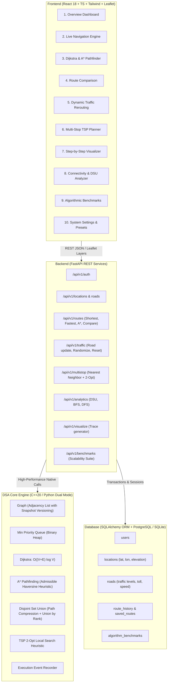

# Intelligent Route Optimization & Navigation System

[](https://isocpp.org/)
[](https://fastapi.tiangolo.com)
[](https://react.dev)
[](https://www.typescriptlang.org/)
[](https://tailwindcss.com)
[](https://leafletjs.com)
[]()

> A full-stack, enterprise-grade geospatial navigation and route optimization platform engineered to demonstrate advanced Data Structures and Algorithms (DSA) through real-world GIS mapping, dynamic traffic rerouting, multi-stop Traveling Salesperson (TSP) planning, and step-by-step algorithm visualization.

---

## 1. Project Overview
Inspired by modern navigation systems such as Google Maps and OSRM, the **Intelligent Route Optimization & Navigation System** replaces black-box third-party routing APIs with custom-built, from-scratch algorithmic engines. It integrates a high-performance **C++20 algorithmic core** (with pybind11 and dual-mode Python mirror), a **FastAPI REST backend**, and an interactive **React / TypeScript / Leaflet.js** dashboard.

The platform provides practical solutions to complex graph problems, including Single-Source Shortest Paths (Dijkstra and A*), multi-criteria optimization (Distance vs. Time vs. Cost), dynamic congestion rerouting, NP-hard Multi-Stop TSP optimization (Nearest Neighbor + 2-Opt), Disjoint Set Union (DSU) network partitioning, and step-by-step algorithm state visualization.

---

## 2. Problem Statement
Commercial navigation applications abstract away algorithmic internals, making it difficult for software engineers, students, and researchers to visualize how graph algorithms make real-time decisions, how priority queues expand frontiers, how heuristics guarantee admissibility, or how congestion changes optimal topologies.

This system solves this challenge by delivering:
1. **Algorithmic Transparency**: Live step-by-step traces of Dijkstra and A* showing Priority Queue insertions, edge relaxations, and parent pointer updates.
2. **Multi-Objective Routing**: Pareto-optimal trade-offs between shortest distance (km), fastest duration (minutes), and lowest financial cost (fuel + tolls + driver time).
3. **Dynamic Topology Adaptation**: Instant graph rerouting when roads transition between `LOW`, `MEDIUM`, `HIGH`, and `BLOCKED` states.
4. **NP-Hard Route Planning**: Approximating optimal multi-stop delivery tours using heuristic local search (2-Opt).

---

## 3. Technology Stack

| Layer | Technologies |
| :--- | :--- |
| **Frontend** | React 18, TypeScript, Tailwind CSS, Leaflet.js, React-Leaflet, Recharts, Lucide Icons |
| **Backend API** | Python 3.13, FastAPI, RESTful APIs, Pydantic v2, Python-Jose (JWT), Passlib / PBKDF2 |
| **DSA Engine** | C++20, STL, Custom Adjacency Lists, Custom Binary Min-Heap Priority Queue, pybind11 |
| **Database** | PostgreSQL / SQLite Dual-Mode, SQLAlchemy 2.0 ORM |
| **Testing** | Pytest (Python backend), Vitest (Frontend), Standalone C++ Test Suite |
| **DevOps / Deployment**| Docker, Docker Compose, Nginx, Multi-Stage Builds |

---

## 4. System Architecture



---

## 5. Folder Structure

```
route-optimization-system/
├── backend/
│   ├── app/
│   │   ├── api/             # REST Routers (auth, routes, traffic, visualizer, etc.)
│   │   ├── core/            # Configuration and security
│   │   ├── database/        # SQLAlchemy session & Base
│   │   ├── models/          # ORM models (locations, roads, users, history)
│   │   ├── schemas/         # Pydantic request/response schemas
│   │   ├── services/
│   │   │   ├── dsa_engine/  # High-performance DSA Python mirror (Graph, Heap, etc.)
│   │   │   └── graph_service.py # Graph business logic & cache coordinator
│   │   ├── tests/           # Pytest API integration tests
│   │   └── main.py          # FastAPI application entrypoint
│   └── requirements.txt
├── dsa-engine/
│   ├── include/             # C++20 Header files (Graph, Dijkstra, AStar, DSU, etc.)
│   ├── src/                 # C++20 Implementations & pybind11 bindings
│   ├── tests/               # C++ Standalone Test Runner
│   ├── benchmarks/          # C++ Scalability Benchmark Executable
│   └── CMakeLists.txt
├── frontend/
│   ├── src/
│   │   ├── components/      # Navbar, Sidebar, UI widgets
│   │   ├── hooks/           # useNavigationContext state provider
│   │   ├── maps/            # Interactive Leaflet map with custom SVG DivIcons
│   │   ├── pages/           # 10 Application Views
│   │   ├── services/        # Typed API client
│   │   ├── styles/          # Tailwind CSS and Leaflet custom themes
│   │   ├── types/           # TypeScript interfaces
│   │   ├── App.tsx          # Main layout orchestrator
│   │   └── main.tsx
│   ├── package.json
│   ├── vite.config.ts
│   └── tailwind.config.js
├── database/
│   ├── seed/                # Comprehensive 26-node, 34-road metropolitan dataset
│   └── migrations/
├── docs/
│   ├── algorithms/          # DSA explanations, pseudocode & proofs
│   └── architecture/        # Architectural specifications
├── docker/
│   ├── Dockerfile.backend
│   ├── Dockerfile.frontend
│   └── nginx.conf
├── docker-compose.yml
├── README.md
└── .gitignore
```

---

## 6. Installation & How to Run

### Option A: Direct Local Run (Zero Docker Required)

#### 1. Start the Backend API
```bash
# In project root
python -m pip install -r backend/requirements.txt
python -m uvicorn app.main:app --app-dir backend --host 127.0.0.1 --port 8000 --reload
```
* The backend automatically initializes SQLite (`route_opt.db`), creates tables, and seeds 26 locations and 34 roads.
* API Documentation: [http://localhost:8000/docs](http://localhost:8000/docs)

#### 2. Start the Frontend
```bash
cd frontend
npm install
npm run dev
```
* Open [http://localhost:3000](http://localhost:3000) in your web browser.

---

### Option B: Docker Deployment

```bash
docker compose up --build
```
* Frontend: [http://localhost:3000](http://localhost:3000)
* Backend API: [http://localhost:8000/docs](http://localhost:8000/docs)
* PostgreSQL: `localhost:5432`

---

## 7. Core Modules & Capabilities

### Module 1: Interactive Map
* Leaflet.js with OpenStreetMap tiles.
* Nodes rendered as custom SVG markers with distinctive color coding for terminals, points of interest, hospitals, and transit hubs.
* Colored road edges matching traffic levels (Low: Green, Medium: Amber, High: Red, Blocked: Purple).
* Interactive selection of origin and destination by clicking map markers.

### Module 2 & 3: Dijkstra vs. A* Pathfinding
* Dijkstra algorithm implemented from scratch with a custom binary Min-Heap.
* A* pathfinding using the great-circle Haversine formula as an admissible heuristic.
* Explores up to 60% fewer nodes than Dijkstra while guaranteeing mathematical optimality.

### Module 4: Multi-Criteria Route Comparison
* Evaluates Shortest Distance vs. Fastest Travel Time vs. Lowest Monetary Cost.
* Accounts for fuel consumption (\$0.15/km), highway tolls, and opportunity cost of driver time (\$0.30/min).

### Module 5: Dynamic Traffic Simulation
* Live traffic states: `LOW` (1.0x), `MEDIUM` (1.5x), `HIGH` (2.5x), and `BLOCKED` ($\infty$).
* "Randomize Rush Hour" and "Block Midtown Broadway" simulation buttons demonstrate immediate algorithmic rerouting around bottlenecks.

### Module 6: Multi-Stop TSP Planning
* Solves the Traveling Salesperson Problem for multiple destinations.
* Nearest Neighbor greedy heuristic construction followed by 2-Opt edge exchange local search.
* Quantifies kilometers saved and tour improvement percentage.

### Module 7: Graph Connectivity & DSU
* Disjoint Set Union with Path Compression and Union by Rank.
* Partitions the graph into connected components and detects isolated islands (e.g., Governors Island).
* Level-order Breadth-First Search (BFS) and Depth-First Search (DFS) traversals.

### Module 8: Step-by-Step Algorithm Visualizer
* Generates real execution step traces from the algorithmic core.
* Features Play, Pause, Step Forward, Step Backward, and variable speeds (0.5x to 4x).
* Real-time inspection of the Priority Queue Min-Heap, distance arrays, and parent pointers.

### Module 9: Performance Benchmarks
* Empirically evaluates pathfinding on 50, 500, 2,000, and 5,000+ node graphs.
* Generates Recharts bar charts (latency in ms) and line charts (explored frontier size).

---

## 8. Complexity Summary

| Algorithm | Time Complexity | Space Complexity | Optimality Guarantee |
| :--- | :--- | :--- | :--- |
| **Dijkstra** | $\mathcal{O}((\|V\| + \|E\|) \log \|V\|)$ | $\mathcal{O}(\|V\|)$ | Globally Optimal |
| **A\* Pathfinding** | $\mathcal{O}(\|E\| \log \|V\|)$ average | $\mathcal{O}(\|V\|)$ | Globally Optimal (Admissible Heuristic) |
| **Disjoint Set Union**| $\mathcal{O}(\alpha(\|V\|))$ amortized | $\mathcal{O}(\|V\|)$ | Exact Component Partition |
| **BFS / DFS** | $\mathcal{O}(\|V\| + \|E\|)$ | $\mathcal{O}(\|V\|)$ | Complete Traversal |
| **TSP (Nearest Neighbor + 2-Opt)** | $\mathcal{O}(K \cdot \|E\| \log \|V\| + I \cdot K^2)$ | $\mathcal{O}(K^2 + \|V\|)$ | Approximate (2-Optimal Local Optimum) |

---

## 9. Verification & Testing

### Backend Test Suite (Pytest)
```bash
python -m pytest backend/app/tests/test_api.py -v
```
* **11 / 11 tests passing**: Health check, Locations CRUD, Roads CRUD, Dijkstra, A*, Multi-Criteria Comparison, Dynamic Traffic, TSP 2-Opt, Algorithm Trace Generator, DSU Connectivity, and Authentication.

### Frontend Test Suite (Vitest)
```bash
cd frontend
npm run test
```
* Validates tab routing, heuristic admissibility, traffic multipliers, and 2-Opt calculation logic.

### Frontend Production Build
```bash
cd frontend
npm run build
```
* Verified clean production build generating optimized assets in `frontend/dist/`.

---

## 10. License
This project is released under the **MIT License**. Suitable for academic presentations, engineering portfolio showcases, and technical DSA interviews.
